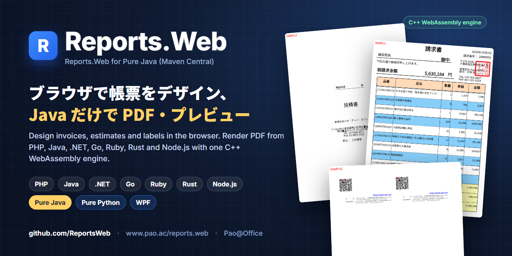
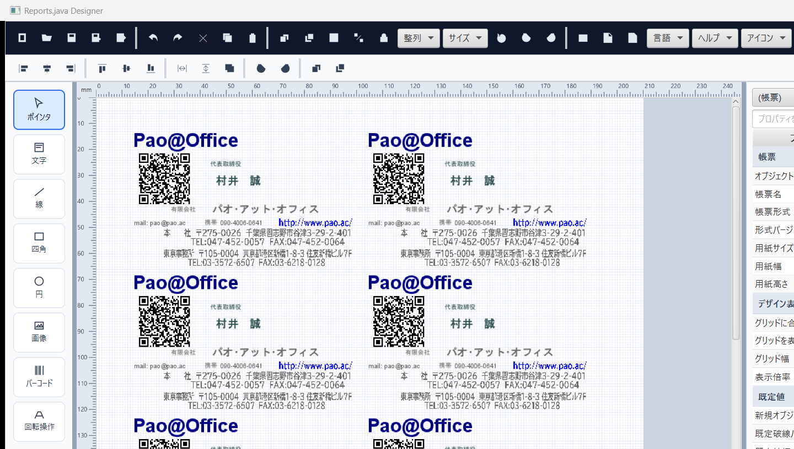
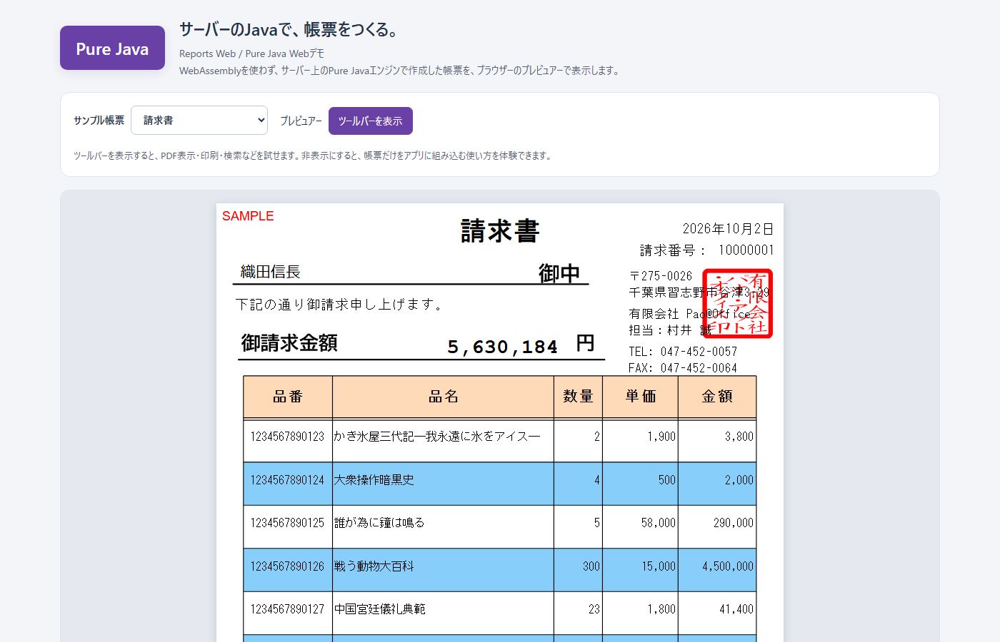
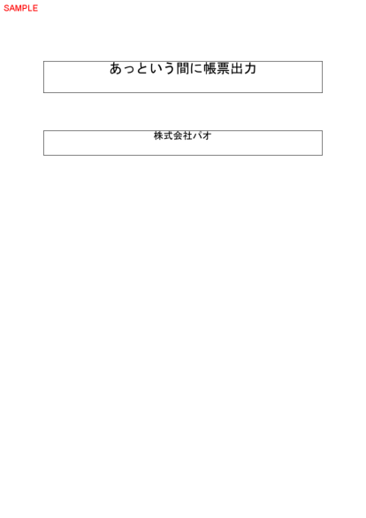

<p align="center"></p>

# Reports.Web — Pure Java サンプル

[](https://central.sonatype.com/artifact/ac.pao/reports-java-engine)
[](https://www.pao.ac/reports.web/)

**Reports.Web** は、帳票をデザインして、いろいろな言語から PDF を作る帳票ツールです。このリポジトリは、**Pure Java（Java 21）** から使うサンプル（製品の配布 ZIP に入っているものと同じ）です。WebAssembly・Node.js は使わず、Java だけで動きます。

帳票定義（`.prepdj`）を読み込んで値を入れ、PDF・SVG・印刷データ（PREPEJ）に出力し、JavaFX やブラウザーでプレビューします。請求書・見積書・郵便番号一覧・名刺など、日本の業務帳票向けです。帳票エンジンは Maven Central の [`ac.pao:reports-java-engine`](https://central.sonatype.com/artifact/ac.pao/reports-java-engine) として、ビルド時に自動で取得されます。

- 製品サイト：https://www.pao.ac/reports.web/
- Maven Central：[`ac.pao:reports-java-engine`](https://central.sonatype.com/artifact/ac.pao/reports-java-engine)（Java 21）
- プログラマーズガイド：https://www.pao.ac/reports.web/manual/programmers/pure-java/

| Pure Java デザイナー（製品に同梱） | 03 ブラウザーでプレビュー |
|---|---|
|  |  |

## サンプルを選ぶ

| # | フォルダー | 内容 |
|:-:|---|---|
| 01 | [01.あっという間に帳票出力](01.あっという間に帳票出力/README.md) | 短い Java コードで PREPEJ・SVG・PDF を生成 |
| 02 | [02.全帳票をパソコンでプレビュー](02.全帳票をパソコンでプレビュー/README.md) | SQLite の業務データから全帳票を作り、JavaFX のプレビューで表示・印刷 |
| 03 | [03.全帳票をWebでプレビュー](03.全帳票をWebでプレビュー/README.md) | Java のサーバーが SVG／PDF を作り、ブラウザーで表示（Docker 可） |
| 04 | [04.Web API・デスクトップ連携](04.Web%20API・デスクトップ連携/README.md) | API から印刷データ（PREPEJ）を受け取り、デスクトップでプレビュー・保存・PDF 化 |

## 必要な環境

- JDK 21 以上（動作確認は JDK 21）。Windows・macOS・Linux
- 初回の Gradle・Maven Central の取得に使うインターネット接続
- 03 と 04 の Server は、Docker Desktop（Docker Compose）でも起動できます

SQLite のインストールは不要です。02・03・04 の Server は、`common/database/sample.db` を読みます。

## クイックスタート

```sh
git clone https://github.com/ReportsWeb/java.git
cd "java/01.あっという間に帳票出力"
./gradlew run        # Windows は .\gradlew.bat run
```

`output/` に `quick-report.pdf`・`quick-report-page-001.svg`・`quick-report.prepej` ができます。

自分のプロジェクトでは、次の 1 行を追加します。

```kotlin
// build.gradle.kts
dependencies { implementation("ac.pao:reports-java-engine:1.0.0") }
```

```xml
<!-- pom.xml -->
<dependency>
  <groupId>ac.pao</groupId>
  <artifactId>reports-java-engine</artifactId>
  <version>1.0.0</version>
</dependency>
```

## コードの要点

```java
// 01: QuickReport.java（抜粋）— 帳票定義を読み込み、値を入れて PREPEJ と PDF に出力
var definition = new ReportDefinitionIO().read(root.resolve("definition/quick-report.prepdj"));
var data = new ReportData();
data.values.putAll(values);
var job = new PreviewJob();
job.pages.add(new PreviewJob.Page(definition, data, 0));
new PreviewJobIO().write(output.resolve("quick-report.prepej"), job);
new PdfExporter().exportPages(
        job.pages.stream().map(p -> new PdfExporter.Page(p.definition, p.data, p.sourcePage)).toList(),
        output.resolve("quick-report.pdf"), PdfExporter.Options.image(), RenderControl.none());
```



## 外部アプリへの組み込み

`SamplePreviewWindow`（02・04 Client）はサンプルに同梱した JavaFX 実装で、エンジン本体の UI クラスではありません。自分のアプリに組み込んだ場合は、帳票以外の操作 UI をまとめて非表示・再表示できます。

```java
var preview = new SamplePreviewWindow(owner, "帳票", definition, data);
preview.setPreviewChromeVisible(false); // メニュー、ツールバー、ステータス、ページ一覧を非表示
preview.show();
preview.setPreviewChromeVisible(true);  // すべて再表示
```

## 体験版と製品版

Maven Central のパッケージは**体験版**で、出力には赤い「SAMPLE」の印が付きます。ご購入後に納品するライセンスファイル（`reports-web.license`）を案内された場所に置くと印が消えます（パッケージの入れ替えは不要）。開発用パソコン 1 台につき 1 ライセンス、運用環境はランタイムライセンスフリーです。

- ご購入・お見積もり：https://www.pao.ac/reports.web/buy.html
- 使用許諾：https://www.pao.ac/reports.web/manual/index.html#16
- 帳票のデザインに使う Pure Java デザイナーは、製品の[体験版 ZIP](https://www.pao.ac/reports.web/index.html#download)に同梱しています。

このリポジトリのサンプルコードは [MIT License](LICENSE) です。Maven Central のパッケージには Reports.Web の使用許諾が適用されます。

## ほかの言語

同じ帳票定義・印刷データを、PHP・Java・.NET・Go・Ruby・Rust・Node.js（WASM 版）と WPF からも使えます。→ https://github.com/ReportsWeb

---

## English

**Reports.Web** is a report designer and PDF engine. This repository contains the **Pure Java (Java 21)** samples shipped in the product ZIP: load a report definition (`.prepdj`), fill values, and export PDF, SVG or print data (PREPEJ), with JavaFX and browser previews. No WebAssembly or Node.js. Built for Japanese business forms (invoices, estimates, postal lists, business cards).

- Package: [`ac.pao:reports-java-engine`](https://central.sonatype.com/artifact/ac.pao/reports-java-engine) on Maven Central, resolved automatically by Gradle.
- Requirements: JDK 21+, Windows / macOS / Linux. Samples 03 and 04 Server also run with Docker Compose.

```sh
git clone https://github.com/ReportsWeb/java.git
cd "java/01.あっという間に帳票出力"
./gradlew run
```

The package is a trial build: output carries a red "SAMPLE" mark until a purchased license file is installed. Sample code: MIT. Package: Reports.Web license.

Pao@Office — https://www.pao.ac/ — info@pao.ac
